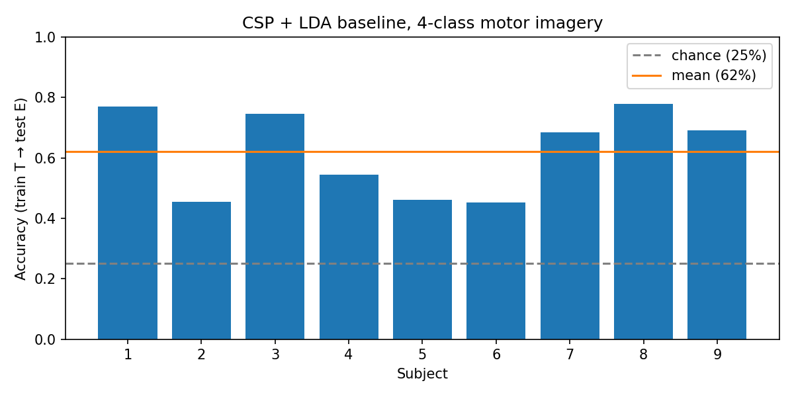
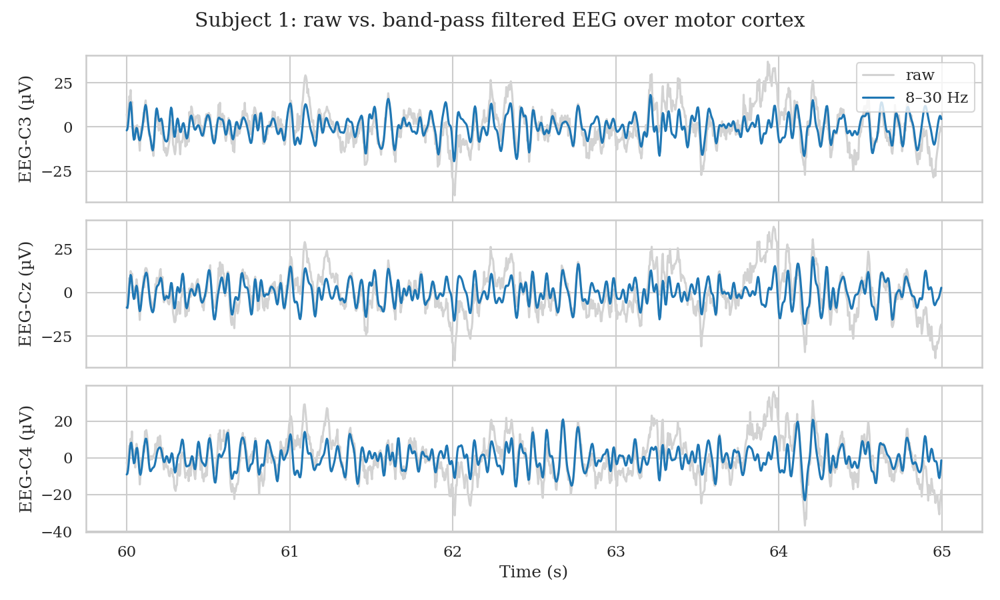

# eeg-motor-imagery-decoder

Project goal: Decoding imagined movements (left hand, right hand, feet, tongue) from EEG data using BCI Competition IV 2a dataset. The overall goal is to build and compare decoders for 4-class motor imagery, with evaluation that prevents data leakage.

## Results so far
**CSP + LDA baseline: 62.0% mean 4-class accuracy across 9 subjects**
(train on day 1, test on day 2; chance = 25%).

- Accuracy varied widely between subjects (45–78%), a common pattern in motor imagery BCIs.
- For subject 1, left & right-hand imagery were decoded more reliably than feet and tongue, which were often confused with each other.

## Plan
- [x] Load data with MNE-Python and inspect channels, sampling rate and trials per class
- [x] Band-pass filter (8–30 Hz) and visualize motor cortex channels (C3, Cz, C4)
- [x] Epoch trials around imagery cues
- [x] Baseline: CSP + LDA with cross-session evaluation (train on session T, test on session E)
- [ ] EEGNet in PyTorch
- [ ] Per-subject analysis and failure cases

## Data
[BCI Competition IV download page](https://www.bbci.de/competition/iv/download)
(dataset 2a)

## Setup
python3 -m venv .venv
source .venv/bin/activate
pip install -r requirements.txt ipykernel